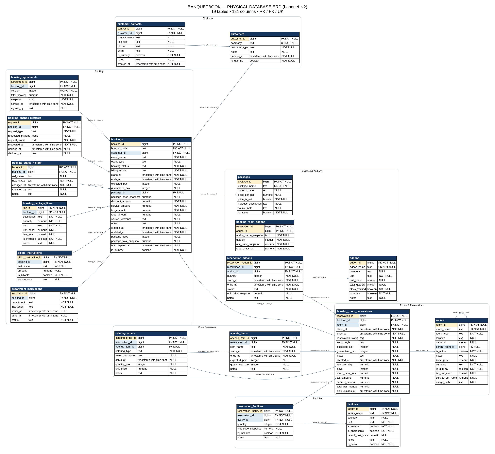

# BanquetBook — Hotel Banquet Booking Management System

A web-based portfolio project that simulates hotel banquet reservation operations using a relational database and a modern web application stack.

**Built with:** Next.js · React · TypeScript · Supabase · PostgreSQL · SQL

---

## 1. Project Overview

BanquetBook is a simulated hotel banquet booking management system created to explore how hotel event reservation processes can be supported by an integrated application and structured relational database.

In hotel banquet operations, a single event reservation involves multiple pieces of information, including customers, event schedules, banquet rooms, packages, additional services, facilities, and pricing.

When these details are handled separately, operational coordination and data consistency can become challenging.

BanquetBook explores how these processes can be organized through a centralized booking workflow and relational database.

> **Project scope:** This is an independent portfolio simulation inspired by hotel banquet operations. It is not an official system of any hotel and is not presented as production software.

## 2. Business Problem

A banquet reservation involves more than simply booking a room. The process requires coordination between several operational components:

- Customer and company information
- Event and reservation schedules
- Room availability and capacity
- Meeting packages and additional services
- Facilities and operational requirements
- Booking status and pricing information

BanquetBook addresses this scenario by organizing the information into related database entities and supporting the reservation process through a web-based interface.

## 3. Booking Workflow

The simulated booking process follows this general sequence:

1. **Customer information** — enter or select customer details.
2. **Event scheduling** — specify the event date, start time, and end time.
3. **Room selection** — select banquet rooms according to capacity and availability.
4. **Package selection** — choose a meeting or event package.
5. **Additional services** — select optional add-ons and facilities.
6. **Validation** — check room availability and validate booking information.
7. **Price calculation** — calculate the booking cost based on selected rooms, packages, and additional services.
8. **Reservation submission** — submit the booking request for database processing.

## 4. Key Features

- Banquet room selection
- Event date and schedule management
- Guest capacity management
- Meeting package selection
- Additional service selection
- Room availability validation
- Booking price calculation
- Reservation submission and database storage
- Structured reservation and customer records

## 5. System Architecture

The project uses a web application connected to a Supabase PostgreSQL database.

```text
             USER
               |
               v
       NEXT.JS APPLICATION
        React + TypeScript
               |
               v
        APPLICATION LOGIC
               |
               v
          SUPABASE
               |
               v
        POSTGRESQL DATABASE
               |
       -------------------
       |        |        |
       v        v        v
    Booking  Customer  Room &
    Records  Records   Package Data
```

**Technology responsibilities**

| Technology | Purpose |
|---|---|
| Next.js | Web application framework |
| React | User interface development |
| TypeScript | Application logic and type safety |
| Supabase | Backend and database platform |
| PostgreSQL | Relational database management |
| SQL | Database queries, constraints, and functions |
| Git & GitHub | Version control and source code repository |

## 6. Database Design

## Database Entity Relationship Diagram

The following diagram represents the physical database
structure of BanquetBook.


## Database Entity Relationship Diagram

The following diagram illustrates the physical database structure of BanquetBook, including its entities, attributes, primary keys, foreign keys, and relationships.


*Figure: BanquetBook Physical Database Entity Relationship Diagram — banquet_v2 schema.*

For a detailed breakdown of all database attributes, refer to the database documentation.

The active database schema audited for this project contains **19 tables** and is designed to organize customer data, bookings, room reservations, packages, and operational requirements.

### Database entities

| Category | Tables |
|---|---|
| Customer | `customers`, `customer_contacts` |
| Booking | `bookings`, `booking_agreements`, `booking_change_requests`, `booking_status_history`, `billing_instructions` |
| Room reservation | `rooms`, `booking_room_reservations` |
| Package & add-ons | `packages`, `booking_package_lines`, `addons`, `reservation_addons`, `booking_room_addons` |
| Facilities | `facilities`, `reservation_facilities` |
| Event operations | `agenda_items`, `catering_orders`, `department_instructions` |

### Database design concepts

The database explores the following concepts:

- Relational database modeling
- Primary keys and foreign keys
- One-to-many relationships
- Many-to-many relationship handling
- Data integrity constraints
- Reservation status history
- Booking transaction management
- Reservation and pricing snapshots
- Database functions and stored procedures

### Database integrity snapshot

Based on the active database audit:

| Metric | Result |
|---|---:|
| Tables | 19 |
| Columns | 164 |
| Primary key constraints | 19 |
| Foreign key constraints | 19 |
| Unique constraints | 8 |
| Check constraints | 159 |
| Total audited constraints | 205 |
| Orphan records across audited FK relationships | 0 |

These figures represent the database state at the time of the audit, not a guarantee of future data integrity.

## 7. Database Functions

The active database includes several functions supporting reservation operations:

| Function | Purpose |
|---|---|
| `check_room_availability` | Checks whether selected rooms are available for a requested schedule |
| `addon_available_quantity` | Retrieves the available quantity of an add-on |
| `get_or_create_customer` | Retrieves an existing customer or creates a customer record |
| `submit_booking` | Processes a booking submission request |

The room availability function checks overlapping reservations and considers active booking statuses such as `Pending` and `Confirmed`.

## 8. Testing & Validation

Testing has been performed on selected database logic and pricing scenarios.

### Room availability function

Six test scenarios were checked against expected results:

| Scenario | Expected result | Observed result |
|---|---|---|
| Room 1 has an overlapping active reservation | Unavailable | Passed |
| Room 6 has an overlapping active reservation | Unavailable | Passed |
| Room 1 has a non-overlapping schedule | Available | Passed |
| Room 6 has a non-overlapping schedule | Available | Passed |
| Room 1 has an expired reservation in the checked period | Available, if no other active conflict exists | Passed |
| New booking starts exactly when the previous reservation ends | Available, if no other active conflict exists | Passed |

### Pricing calculation

The frontend pricing calculation was compared with an independent SQL simulation for one test scenario.

The tested scenario used multiple rooms, a two-day booking period, a meeting package, and an additional service.

The frontend and independent SQL simulation produced the same total for that scenario, with a difference of **Rp0**.

### Data integrity

The active database audit checked all 19 declared foreign key relationships. No orphan records were found in the audited relationships.

### Testing limitations

The results above cover selected database checks and an independent pricing simulation. They do **not** establish that the complete booking submission workflow has passed end-to-end testing.

Full end-to-end validation of booking submission, database transactions, and all application-to-database interactions remains part of the development work.

## 9. Project Status

**Current status: Development and testing**

Completed or audited:

- Web application foundation
- Relational database structure
- Selected database functions
- Room availability test scenarios
- Database foreign key integrity audit
- One independent SQL pricing comparison

Still requiring further validation:

- Complete end-to-end booking submission
- Consistency between database migration files and the active 19-table schema
- Broader application and database integration testing
- Additional edge-case and transaction testing

## 10. Project Structure

```text
BanquetBook/
├── public/
├── src/
├── supabase/
│   └── migrations/
├── .vscode/
├── package.json
├── package-lock.json
├── next.config.mjs
├── tsconfig.json
├── .gitignore
└── README.md
```

## 11. Running the Project Locally

### Prerequisites

- Node.js and npm
- Git
- A Supabase project with the required database configuration

### Installation

Clone the repository:

```bash
git clone https://github.com/sahrularief378-web/BanquetBook.git
```

Navigate to the project directory:

```bash
cd BanquetBook
```

Install dependencies:

```bash
npm install
```

Configure the required Supabase environment variables according to the application's source code and configuration.

Start the development server:

```bash
npm run dev
```

Open the application at:

```text
http://localhost:3000
```

**Note:** The database migration files and active database schema are still being synchronized. A complete database setup from the repository alone should not be assumed until that work is finished.

## 12. Learning Outcomes

Through this project, I explored how database concepts can be applied to a real-world-inspired hospitality business process.

Key areas of learning include:

- Translating operational requirements into database entities and relationships
- Designing relational database structures
- Writing SQL queries and database functions
- Implementing room availability validation
- Understanding booking transactions and data integrity
- Connecting application workflows with database operations
- Applying database development concepts to a hospitality use case

## 13. Future Improvements

- Synchronize all database migration files with the active schema
- Complete end-to-end booking submission testing
- Improve automated database testing
- Add reporting and operational analytics
- Develop a dashboard for booking and room utilization insights
- Deploy a public demo when the application is ready

## 14. Author

**Sahrul Arief**

Information Systems | Database Development | Data Engineering

GitHub: [@sahrularief378-web](https://github.com/sahrularief378-web)

Project Repository: [BanquetBook](https://github.com/sahrularief378-web/BanquetBook)

---

*BanquetBook is an independent portfolio project developed to demonstrate the application of information systems and relational database concepts to hotel banquet operations.*
