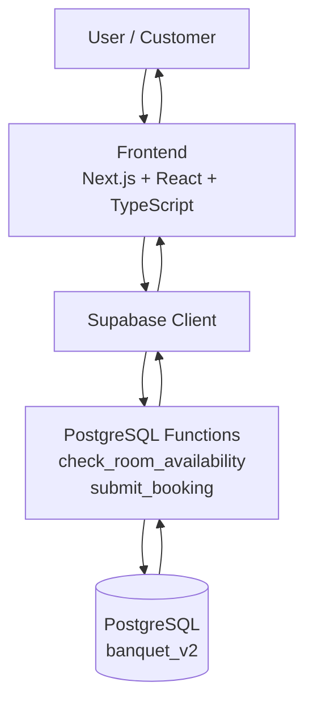
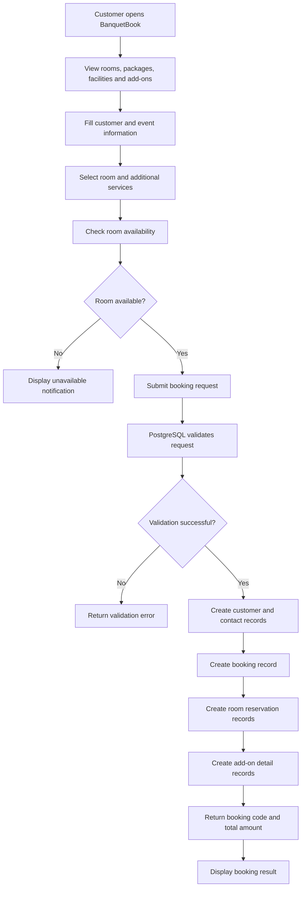

# BanquetBook – Database Architecture & Data Flow

## 1. Overview

BanquetBook merupakan aplikasi simulasi pemesanan ruangan banquet hotel yang dirancang untuk mengelola informasi pelanggan, jadwal acara, reservasi ruangan, paket, dan layanan tambahan.

Sistem menggunakan arsitektur aplikasi web dengan Next.js, React, TypeScript, Supabase, dan PostgreSQL.

Dokumentasi ini menjelaskan komponen utama sistem serta aliran data dari pengguna hingga tersimpan dalam database.

## 2. Technology Stack

| Component | Technology | Function |
|---|---|---|
| Frontend Framework | Next.js | Membangun aplikasi web |
| UI Library | React | Mengelola komponen antarmuka |
| Programming Language | TypeScript | Menangani logika aplikasi dengan tipe data |
| Backend Platform | Supabase | Menyediakan layanan database dan RPC |
| Database | PostgreSQL | Menyimpan dan mengelola data relasional |
| Database Schema | banquet_v2 | Mengelompokkan tabel dan fungsi database |
| SQL | PostgreSQL SQL | Mengelola struktur, validasi, dan transaksi data |

## 3. System Architecture

Secara umum, arsitektur BanquetBook terdiri dari tiga lapisan utama:

1. Presentation Layer: antarmuka yang digunakan pelanggan untuk melihat informasi dan mengisi formulir pemesanan.
2. Application Layer: menangani interaksi pengguna, pengolahan data, dan komunikasi dengan Supabase.
3. Database Layer: PostgreSQL menyimpan data dan menjalankan fungsi untuk validasi serta pemrosesan booking.

### Architecture Diagram

## 4. Main Database Components

Database menggunakan schema `banquet_v2` yang terdiri dari sembilan tabel.

| Component | Responsibility |
|---|---|
| customers | Menyimpan identitas pelanggan |
| customer_contacts | Menyimpan informasi kontak pelanggan |
| bookings | Menyimpan transaksi utama booking |
| rooms | Menyimpan katalog ruangan |
| packages | Menyimpan katalog paket |
| booking_room_reservations | Menyimpan detail reservasi ruangan |
| addons | Menyimpan katalog layanan tambahan |
| booking_room_addons | Menyimpan detail add-ons yang dipilih |
| facilities | Menyimpan katalog fasilitas |

## 5. Booking Data Flow

Proses booking dimulai ketika pelanggan mengakses aplikasi dan mengisi informasi pemesanan.

### Data Flow Diagram

## 6. Database Processing

BanquetBook menggunakan dua fungsi utama PostgreSQL untuk mendukung proses pemesanan.

### 6.1 check_room_availability()

Fungsi ini digunakan untuk memeriksa ketersediaan ruangan berdasarkan:

- ID ruangan yang dipilih.
- Waktu mulai acara.
- Waktu selesai acara.
- Jadwal reservasi yang sudah tersimpan.
- Status booking dan masa berlaku hold.

Fungsi mengembalikan informasi apakah ruangan tersedia atau tidak.

### 6.2 submit_booking()

Fungsi ini menangani proses penyimpanan booking ke database.

Proses utamanya meliputi:

1. Memvalidasi format dan informasi permintaan.
2. Memvalidasi jadwal serta jumlah peserta.
3. Memeriksa paket dan harga yang dipilih.
4. Memeriksa ketersediaan ruangan.
5. Mengunci proses terkait ruangan untuk mengurangi risiko pemesanan bersamaan.
6. Memvalidasi add-ons dan harga.
7. Menghitung total biaya.
8. Menyimpan data pelanggan dan kontak.
9. Menyimpan data booking.
10. Menyimpan detail reservasi ruangan dan add-ons.
11. Mengembalikan booking code dan total biaya.

Proses penyimpanan dijalankan dalam satu transaksi database sehingga kegagalan proses akan membatalkan perubahan transaksi tersebut.

## 7. Data Storage Flow

Data transaksi disimpan ke beberapa tabel sesuai tanggung jawabnya.

| Process | Destination Table |
|---|---|
| Customer information | customers |
| Contact information | customer_contacts |
| Main booking information | bookings |
| Room reservation details | booking_room_reservations |
| Selected add-on details | booking_room_addons |

Data katalog seperti ruangan, paket, fasilitas, dan add-ons disimpan secara terpisah agar dapat digunakan kembali dalam proses pemesanan.

## 8. Data Consistency

Beberapa mekanisme digunakan untuk menjaga konsistensi data:

- Foreign Key menjaga hubungan antar tabel.
- Primary Key memastikan identitas record bersifat unik.
- Unique constraint mencegah kode booking duplikat.
- Check constraint membatasi nilai yang tidak valid.
- Transaction menjaga proses penyimpanan tetap konsisten.
- Advisory lock membantu mengatur proses pemesanan ruangan secara bersamaan.
- Price snapshot menyimpan informasi harga pada saat transaksi dilakukan.

## 9. Security Considerations

Database menggunakan Row Level Security (RLS) pada seluruh tabel.

Akses baca publik diberikan secara selektif pada katalog aktif seperti:

- rooms
- packages
- facilities
- addons

Tabel transaksi dan pelanggan tidak diberikan akses baca publik secara langsung melalui kebijakan tersebut. Fungsi database digunakan untuk menangani proses booking sesuai hak akses yang ditentukan.

## 10. Project Scope

BanquetBook merupakan proyek portofolio dan simulasi sistem pemesanan banquet hotel.

Dokumentasi ini menjelaskan rancangan arsitektur dan aliran proses berdasarkan implementasi database serta komponen aplikasi yang digunakan.

Pengujian integrasi booking secara end-to-end tetap perlu dilakukan pada lingkungan staging sebelum sistem dapat dinyatakan siap digunakan secara operasional.

## 11. Source

Dokumentasi disusun berdasarkan:

- Database migration: `supabase/migrations/20261102220000_banquet_v2_schema.sql`
- Database design: `supabase/DESIGN.md`
- Database documentation: `supabase/README.md`
- Application stack: Next.js, React, TypeScript, Supabase, dan PostgreSQL
