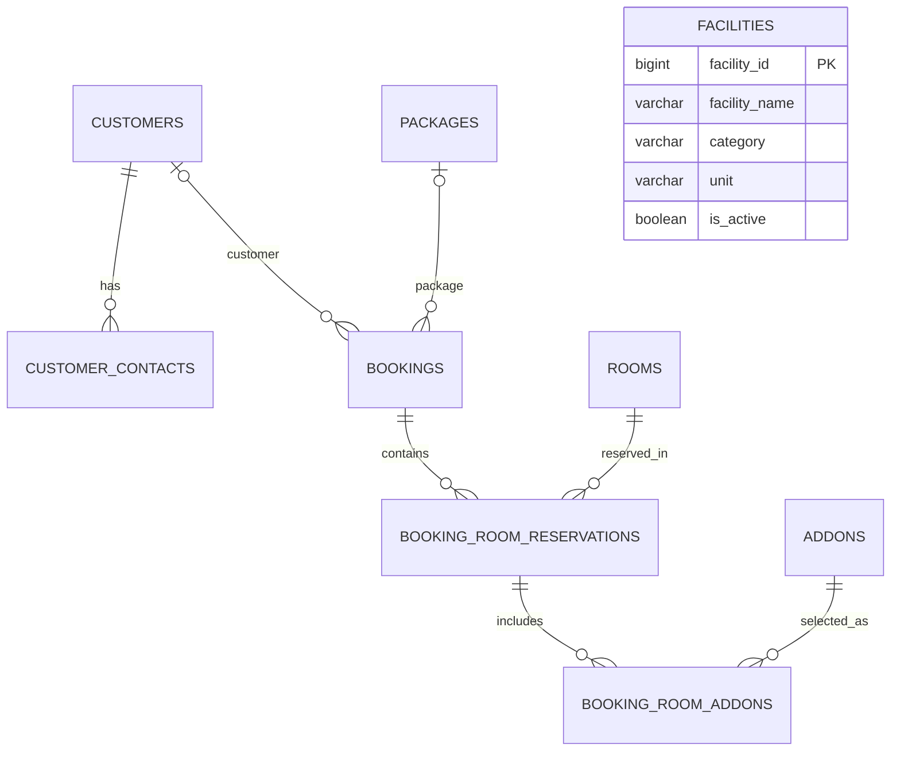

# BanquetBook – Entity Relationship Diagram (ERD)

## 1. Overview

BanquetBook menggunakan database PostgreSQL dengan schema `banquet_v2`.

Database ini dirancang untuk mengelola data pelanggan, kontak, pemesanan banquet, ruangan, paket, fasilitas, dan add-ons.

## 2. ERD Diagram

## 3. Database Entities

| No. | Table | Description |
|---|---|---|
| 1 | customers | Menyimpan data pelanggan atau perusahaan |
| 2 | customer_contacts | Menyimpan informasi kontak pelanggan |
| 3 | bookings | Menyimpan data utama pemesanan banquet |
| 4 | rooms | Menyimpan data ruangan banquet |
| 5 | packages | Menyimpan data paket meeting atau event |
| 6 | booking_room_reservations | Menyimpan detail reservasi ruangan |
| 7 | addons | Menyimpan data tambahan layanan atau perlengkapan |
| 8 | booking_room_addons | Menyimpan detail add-ons pada reservasi |
| 9 | facilities | Menyimpan data fasilitas ruangan |

## 4. Relationship Explanation

- Customers → Customer Contacts: satu pelanggan dapat memiliki beberapa kontak.
- Customers → Bookings: satu pelanggan dapat memiliki beberapa booking; customer pada booking dapat kosong.
- Packages → Bookings: satu paket dapat digunakan pada beberapa booking; paket pada booking dapat kosong.
- Bookings → Booking Room Reservations: satu booking dapat memiliki beberapa reservasi ruangan.
- Rooms → Booking Room Reservations: satu ruangan dapat muncul dalam beberapa reservasi.
- Booking Room Reservations → Booking Room Addons: satu reservasi dapat memiliki beberapa add-ons.
- Addons → Booking Room Addons: satu add-on dapat digunakan pada beberapa reservasi.

## 5. Important Notes

- Primary Key (PK) digunakan sebagai identitas unik setiap record.
- Foreign Key (FK) digunakan untuk menghubungkan tabel yang saling berelasi.
- `booking_room_reservations` berfungsi sebagai tabel detail reservasi ruangan.
- `booking_room_addons` merupakan tabel penghubung antara reservasi ruangan dan add-ons.
- `facilities` belum memiliki Foreign Key pada schema saat ini sehingga ditampilkan sebagai entitas mandiri.
- Database menggunakan snapshot harga pada detail add-ons untuk menjaga catatan transaksi tetap konsisten meskipun harga katalog berubah.
    